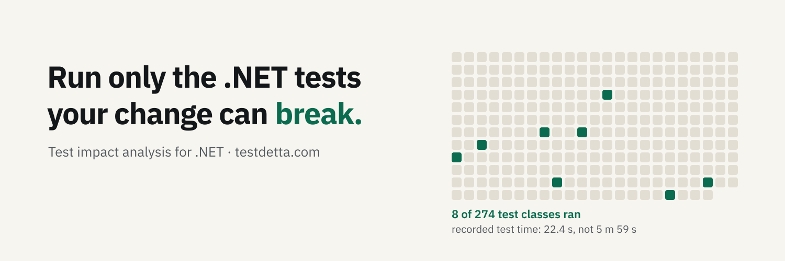

<picture>
  <source media="(prefers-color-scheme: dark)" srcset="banner-dark.png">
  
</picture>

**TestDetta reads your pull request's diff and runs just the .NET test classes that can observe it.**
Everything else is skipped, so CI gets faster without guessing. When the analysis cannot be sure,
it runs more tests, not fewer: a missed test is a bug, an extra test only costs CI time.
[Where it still has limits →](https://testdetta.com/docs/limitations/)

> **Not released yet.** The `td` tool and the GitHub Action are published at launch. Until then you
> can read how it works, how it decides, and how it was measured.

## A real change

A change to [OpenTelemetry .NET](https://github.com/open-telemetry/opentelemetry-dotnet) (commit `f9dd754`):

| | Test classes | Recorded test time |
|---|---:|---:|
| All tests | 274 | 5 m 59 s |
| TestDetta | **8** | **22.4 s** |

The 8 classes run or reference the changed code; the other 266 have no path from the change.
[See the whole run →](https://testdetta.com/docs/examples/)

## How it decides

1. **Projects.** Changed files are mapped to their projects and followed through project references.
2. **Symbols.** Old and new C#, Visual Basic and F# syntax trees are compared, so a comment or whitespace edit selects nothing.
3. **Coverage.** A map of which test class ran which method gives the classes for changed code directly.
4. **Names.** New code, fields and constants are traced through the source by name.
5. **Fallbacks.** A change that cannot be traced, such as `appsettings.json`, runs the whole test project.

[More on how it decides →](https://testdetta.com/docs/how-it-works/) ·
[How it is measured →](https://testdetta.com/docs/validate/)

## Runs in your CI

GitHub Actions, GitLab CI, Jenkins, Azure DevOps and Bitbucket. Your source code, coverage maps and
test results stay on your machines and in your CI; TestDetta does not upload them.

**Planned at launch:** free for public repositories, 30 days free for private ones, no card. A license
problem never fails a build: every test runs instead. Licensing is not switched on yet.

  <a href="https://testdetta.com/docs/">Docs</a> ·
  <a href="https://testdetta.com/pricing/">Pricing</a> ·
  <a href="https://x.com/testdetta">X</a> ·
  <a href="https://bsky.app/profile/testdetta.com">Bluesky</a> ·
  <a href="https://www.linkedin.com/company/testdetta/">LinkedIn</a> ·
  <a href="mailto:support@testdetta.com">support@testdetta.com</a>

